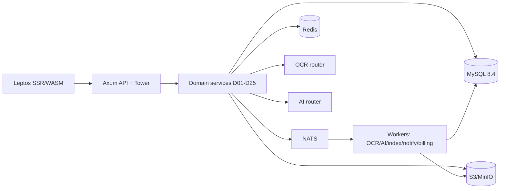
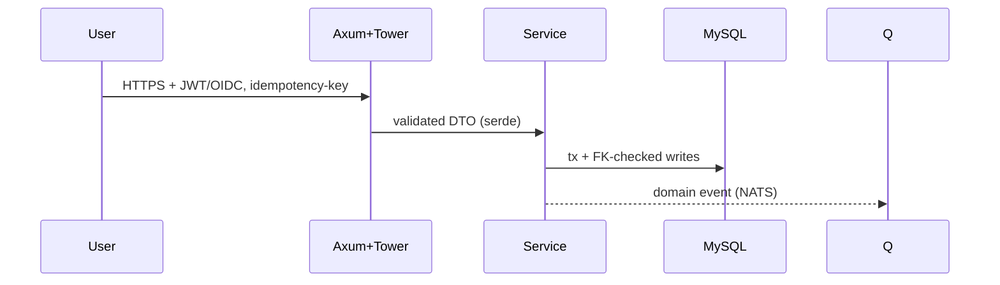

# System Architecture (planning)
## Style
Modular monolith (single Rust binary + Leptos SSR), DDD bounded contexts per domain (D01-D25),
clean-architecture layering inside modules (handler -> service -> repo), ports/traits for
OCR/AI/storage/events. Event-driven via NATS subjects (`legal.<tenant>.<domain>.<event>.v1`);
Redis for cache/locks/rate-limit; S3/MinIO objects; Tantivy search; Qdrant optional vectors.

## Request path

## Workers/idempotency/retries
At-least-once delivery; consumer idempotency keys + dedupe table; exponential backoff w/ jitter;
poison messages to DLQ + error inbox; saga/compensation for cross-module ops (no 2PC).
## Extraction triggers
p95 breach sustained, team contention, blast-radius need, or regulatory isolation — then extract
behind versioned API with dual-run.
## ADR log
See 00-EXECUTIVE/DECISIONS.md. Crate baselines: axum 0.8.9, tower-http 0.7, tokio 1.54.x,
sqlx 0.9 (MSRV 1.94), serde 1.x, leptos stable 0.8.23 (no RC).
