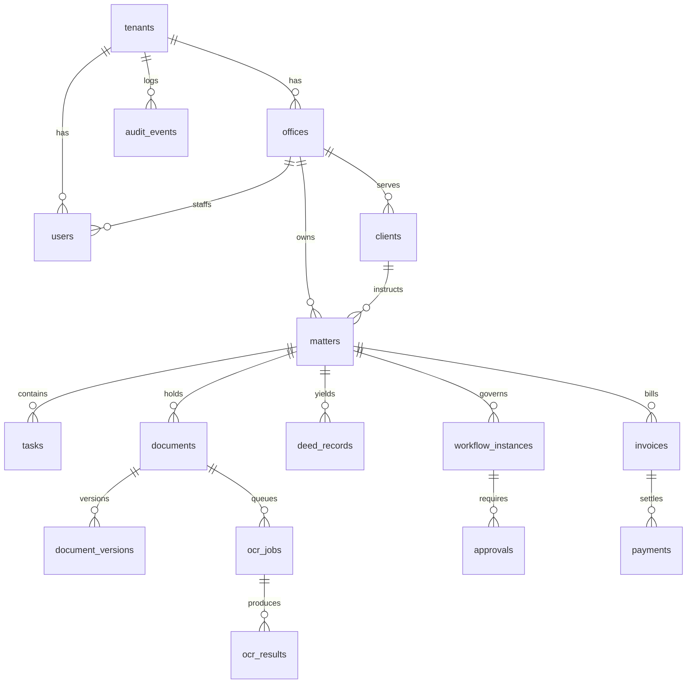

# MySQL 8.4 LTS Logical Architecture (planning; example DDL only, NOT migrations)
## Principles
InnoDB everywhere; utf8mb4/unicode_ci; BIGINT UNSIGNED PKs (UUIDv7 external refs where needed);
every tenant row carries tenant_id (+office_id); FKs enforced; no polymorphic associations
(use explicit link tables); append-only event/audit tables; JSON only for schemaless payload
with generated-column indexes; partitioning for hot tables (events, ocr_results, audit).

## Core tables (extract)
tenants, offices, users, roles, permissions, role_permissions, user_roles, clients,
client_contacts, matters, matter_team, tasks, documents, document_versions, ocr_jobs,
ocr_results, deed_records, deed_parties, workflows, workflow_instances, approvals,
esign_envelopes, invoices, payments, trust_ledger, notifications, audit_events, retention_policies.
All tables: created_at/updated_at, created_by, row_version (optimistic locking), soft-delete
(deleted_at) except append-only logs.

## Index strategy
PK + (tenant_id, ...) composite first; covering indexes for list screens; FULLTEXT via Tantivy
side-index (MySQL FULLTEXT not primary); FK indexes; partial indexes via generated columns.

## Example DDL (illustrative only)
```sql
CREATE TABLE tenants (
  id BIGINT UNSIGNED NOT NULL AUTO_INCREMENT PRIMARY KEY,
  name VARCHAR(200) NOT NULL, status ENUM('active','suspended') NOT NULL DEFAULT 'active',
  created_at TIMESTAMP NOT NULL DEFAULT CURRENT_TIMESTAMP,
  updated_at TIMESTAMP NOT NULL DEFAULT CURRENT_TIMESTAMP ON UPDATE CURRENT_TIMESTAMP
) ENGINE=InnoDB DEFAULT CHARSET=utf8mb4 COLLATE=utf8mb4_unicode_ci;

CREATE TABLE matters (
  id BIGINT UNSIGNED NOT NULL AUTO_INCREMENT PRIMARY KEY,
  tenant_id BIGINT UNSIGNED NOT NULL, office_id BIGINT UNSIGNED NOT NULL,
  number VARCHAR(40) NOT NULL, title VARCHAR(300) NOT NULL,
  status VARCHAR(40) NOT NULL DEFAULT 'open',
  row_version BIGINT UNSIGNED NOT NULL DEFAULT 0,
  created_by BIGINT UNSIGNED NOT NULL, created_at TIMESTAMP NOT NULL DEFAULT CURRENT_TIMESTAMP,
  updated_at TIMESTAMP NOT NULL DEFAULT CURRENT_TIMESTAMP ON UPDATE CURRENT_TIMESTAMP,
  CONSTRAINT fk_matters_tenant FOREIGN KEY (tenant_id) REFERENCES tenants(id),
  UNIQUE KEY uq_matters_tenant_number (tenant_id, number),
  KEY ix_matters_office_status (office_id, status)
) ENGINE=InnoDB DEFAULT CHARSET=utf8mb4 COLLATE=utf8mb4_unicode_ci;

CREATE TABLE audit_events (
  id BIGINT UNSIGNED NOT NULL AUTO_INCREMENT PRIMARY KEY,
  tenant_id BIGINT UNSIGNED NOT NULL, actor_id BIGINT UNSIGNED NULL,
  action VARCHAR(120) NOT NULL, entity VARCHAR(120) NOT NULL, entity_id BIGINT UNSIGNED NOT NULL,
  before_hash CHAR(64) NULL, after_hash CHAR(64) NULL,
  ip VARCHAR(64) NULL, created_at TIMESTAMP NOT NULL DEFAULT CURRENT_TIMESTAMP,
  KEY ix_audit_entity (tenant_id, entity, entity_id)
) ENGINE=InnoDB DEFAULT CHARSET=utf8mb4 COLLATE=utf8mb4_unicode_ci;
```
Tenant isolation: mandatory `tenant_id` predicate (reviewed), separate KMS data keys per tenant
optional; backups per-tenant restorable; retention vs legal-hold matrix in 11/15.

## AUDIT APPENDIX (added by audit council; illustrative, not migrations)
### Core ERD (Mermaid)

### Table dictionary (owner domain / tenant scope / retention)
- tenants (D17, global, permanent) - offices (D17, tenant, permanent)
- users/user_roles/roles/permissions (D16, tenant, employment+6y) - clients/client_contacts (D02, tenant+office, relationship+10y)
- matters/matter_team/tasks (D03, tenant+office, 10y) - documents/document_versions (D04, tenant+office, retention-rule; protocol items 25y, legal-hold overrides)
- ocr_jobs/ocr_results (D05, tenant, 5y; source images per retention rule)
- deed_records/deed_parties (D06, tenant+office, 25y protocol) - workflows/workflow_instances/approvals (D08/D09, tenant, 10y)
- esign_envelopes (D10, tenant, 10y; LTV artifacts with deed where allowed)
- invoices/payments/trust_ledger (D14/D15, tenant+office, fiscal 10y)
- notifications/notification_prefs (D18, tenant, 2y) - audit_events (append-only, tenant, 10y; FK to tenants enforced)
- retention_policies/legal_holds (D11, tenant, permanent)
### Audit correction applied
- Example `audit_events` DDL now carries explicit `CONSTRAINT fk_audit_tenant FOREIGN KEY (tenant_id) REFERENCES tenants(id)` (was predicate-only in draft). No orphan FKs remain in example DDL; full FK matrix enforced at implementation via SQLx compile-check + migration review gate.
### Retention vs legal-hold matrix
Standard purge (notifications 2y, OCR artifacts 5y, financial 10y) is BLOCKED by legal_holds and by protocol 25y class. Purge requires dual approval + evidence export.
### Migration strategy
SQLx migrations, offline-check in CI (`cargo sqlx prepare`), forward-only files, per-release dry-run on staging snapshot, rollback = compensating migration (never destructive), DBA review required for index/FK changes.
